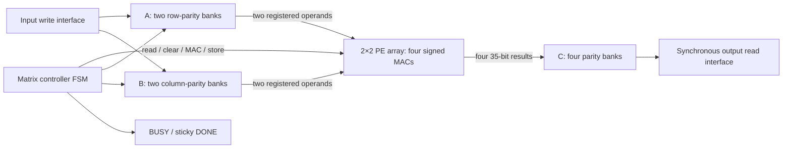
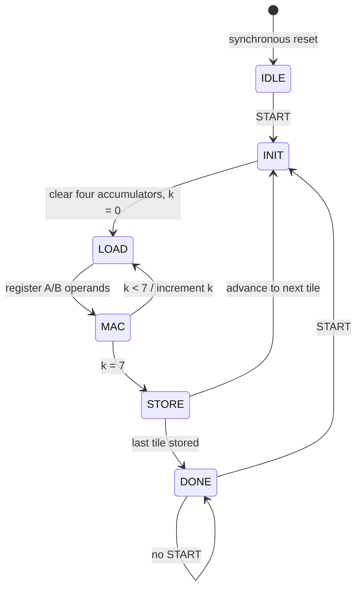

# FSM 8×8 signed matrix multiplication accelerator

This standalone Verilog-2001 design computes `C = A × B` for two 8×8 signed
INT16 matrices. Four MACs form a 2×2 processing element (PE) array. The controller
reuses the array across 16 output tiles, accumulating each result locally in a
signed 35-bit register before storing it. The reusable core needs no CPU or ROM.

The intended FPGA is Cyclone IV EP4CE6. Device fitting, DSP/RAM mapping and timing
must be verified in Quartus before hardware use. This directory contains no
board pin assignments or Quartus project files.

## Architecture and files



| File | Responsibility |
| --- | --- |
| `rtl/mac.v` | Signed 16×16 multiplication, explicit 32-to-35-bit sign extension, accumulator clear/enable |
| `rtl/pe_array.v` | Four MACs: `c00 += a0*b0`, `c01 += a0*b1`, `c10 += a1*b0`, `c11 += a1*b1` |
| `rtl/matrix_controller.v` | Tile/index tracking, memory controls, status and repeatable START |
| `rtl/matrix_buffer.v` | Banked A/B/C arrays and synchronous read ports |
| `rtl/matrix_accelerator.v` | Reusable core and external access arbitration |
| `rtl/standalone_top.v` | Initialize ROMs, load the core, start it and check all 64 results |
| `tb/tb_mac.v` | Self-checking arithmetic, clear, reset and enable tests |
| `tb/tb_pe_array.v` | Self-checking PE broadcast/mapping and independent accumulation tests |
| `tb/tb_matrix_accelerator.v` | Whole-matrix golden comparisons and interface tests |
| `tb/tb_standalone_top.v` | Successful checker, deliberately corrupted expectation, reset and repeat execution |
| `scripts/golden_model.py` | Independent Python integer matrix multiplication and deterministic hex generation |
| `scripts/run_sim.sh` | Generate vectors, compile Verilog-2001 and run all four testbenches |
| `memory/matrix_a.hex`, `memory/matrix_b.hex` | Standalone input ROM contents |
| `memory/c_expected.hex` | Standalone reference ROM contents |

`build/` contains generated test vectors and simulator executables and is ignored
by Git. The three standalone ROM files are included in the source tree.

## Control and cycle behavior



Tiles traverse columns first, then rows. Tile `(tr, tc)` covers output rows
`2*tr, 2*tr+1` and columns `2*tc, 2*tc+1`. On each `k`, the two A values broadcast
across PE columns and the two B values broadcast across PE rows. Accumulators
stay in the PEs for all eight products; they are cleared again for every tile.

Let edge 0 be the rising edge that accepts START:

| Edge relative to START | Action |
| --- | --- |
| 0 | Enter INIT; BUSY asserts and DONE clears |
| 1 | Clear the four accumulators |
| 2 | Register the four operands for `k=0` in LOAD |
| 3 | Accumulate the first products in MAC |
| 4–17 | Seven further LOAD/MAC pairs; final accumulation at edge 17 |
| 18 | Store all four completed results; enter the next tile's INIT |
| 288 | Store the last tile; BUSY deasserts and DONE asserts |

Each tile takes `1 + 8*(1+1) + 1 = 18` cycles. Core latency is therefore
**288 cycles after accepted START**, excluding host loading and readback. There
are 128 active MAC cycles performing 512 scalar products. Synchronous reads,
clear and store account for the remaining cycles. No pipelined overlap is assumed.

## Memory organization and signed values

All host addresses are row-major: `address = row*8 + column`, equivalently
`{row[2:0], column[2:0]}`.

| Matrix | Logical storage | Bank selection | Address within a bank |
| --- | --- | --- | --- |
| A | Two banks of 32×16 bits | `row[0]` | `{row[2:1], column[2:0]}` |
| B | Two banks of 32×16 bits | `column[0]` | `{row[2:0], column[2:1]}` |
| C | Four banks of 16×35 bits | `{row[0], column[0]}` | `{row[2:1], column[2:1]}` |

Each A/B bank supplies one synchronous operand read. Each C bank receives one
result write in STORE. For host readback, four C bank outputs and the bank
selector register on the same edge; their mux presents the selected value.
Each bank needs at most one write and one read port. The core does not rely on
four independent read ports in a single RAM. Host access gating prevents
read/write collisions during computation.

The core holds 4,288 matrix data bits plus datapath/control registers. Arrays and
their data outputs are intentionally not reset, preserving RAM inference
options. Actual physical RAM usage depends on the synthesis tool's mapping of
these small banks; the logical bank count is not a measured M9K count.

Inputs and outputs use two's-complement representation. A product is signed
32-bit and is explicitly sign-extended before addition. Eight INT16 products
range from −8,589,672,448 to +8,589,934,592, safely inside signed INT35. There is no
saturation or rounding. Hex files have 64 row-major words: four hex digits per
input and nine per output, masked to 35 bits for negative output values.

## Reusable core interface

All requests sample on rising `clk`. `rst_n` is **synchronous active low** and
must be low across at least one rising edge. Reset aborts a computation, clears
status and accumulators, and invalidates read responses; it does not clear RAM.

| Signal | Direction / width | Contract |
| --- | --- | --- |
| `clk` | Input / 1 | Single clock domain |
| `rst_n` | Input / 1 | Synchronous active-low reset |
| `start` | Input / 1 | Accepted when `busy=0`; START has priority over host reads/writes |
| `busy` | Output / 1 | High in INIT, LOAD, MAC and STORE |
| `done` | Output / 1 | All 64 C elements have been stored; sticky until accepted START or reset |
| `input_write_enable` | Input / 1 | Write when `rst_n && !busy && !start` |
| `input_matrix_select` | Input / 1 | `0`: A; `1`: B |
| `input_address` | Input / 6 | Row-major input address 0–63 |
| `input_data` | Input / signed 16 | Input word |
| `output_read_enable` | Input / 1 | Read accepted when `rst_n && done && !start` |
| `output_address` | Input / 6 | Row-major C address 0–63 |
| `output_data` | Output / signed 35 | Synchronous read response |
| `output_read_valid` | Output / 1 | High for the cycle following each accepted read edge |

Load all 64 A and all 64 B elements before the first START. One word can be
written each cycle. Pulse START for one cycle, wait for DONE, then request C
reads. If address and read enable are set before edge N, data and valid update
after edge N and can be consumed by downstream sequential logic at edge N+1.
Consecutive requests yield consecutive responses. An unaccepted request makes
`output_read_valid` low after that edge. Output data is unspecified before its
first valid response and across reset; outside reset it holds between reads.

START pulses during BUSY are ignored, with no pending request queue. A START
held high through completion initiates another run on the next idle edge. Use
one-cycle pulses for explicit control. Writes during BUSY and reads before DONE
are ignored. Reads on the final STORE edge are not yet accepted; request them
once DONE is visible. On an accepted START edge, simultaneous writes and reads
are discarded.

After completion, A/B can be reloaded while the previous DONE stays high, and C
can still be read until the next START. An unchanged input matrix may be reused.
Every accepted START resets tile/index tracking and clears all PEs before use.

## Standalone wrapper

`standalone_top` has only `clk`, `rst_n`, `pass`, `fail` and `done` ports. It loads
the A/B ROMs into the reusable core, starts multiplication and compares every C
element with the independent expected ROM. The three file path parameters are
`A_INIT_FILE`, `B_INIT_FILE` and `C_INIT_FILE`, defaulting to the files in
`memory/`. Paths are resolved relative to the tool's working directory. Run tools
from this `fsm` directory or override the paths.

The wrapper uses `$readmemh` only to initialize ROM arrays; no delays or
simulation-only stimulus appears in synthesizable RTL. ROM reads are synchronous.
For eventual Quartus use, make these initialization files available to the
project and verify inferred ROM initialization in synthesis. The core itself
contains no initialization files or `initial` blocks.

After reset release, the wrapper takes 610 rising edges: 192 input-loading edges
(ROM read, A write, B write per address), one START edge, 288 computation edges,
one completion-observation edge and 128 read/compare edges. `done` asserts only
after all 64 comparisons; `pass` asserts only if all match. `fail` latches any
mismatch or missing response. Terminal status remains until reset, which starts
a fresh standalone execution. There is no internal watchdog; the testbench
checks a timeout.

## Simulation

See [RUN_SIM.md](RUN_SIM.md) for step-by-step setup, commands for this workspace,
expected output and troubleshooting.

Requirements: Python 3, Bash, and Icarus Verilog (`iverilog`, `vvp`). No Python
packages, Quartus license or FPGA hardware are needed.

```bash
cd matrix_multiply_accelerate/software/fpga_source_code/fsm
bash scripts/run_sim.sh
```

The runner resolves its own directory, so it also works when called by absolute
path. It regenerates vectors, compiles with `-g2001 -Wall`, runs the MAC, PE,
accelerator and standalone tests in order, and exits immediately on any failure.
Testbenches use Icarus's `$finish_and_return(1)` to return a failing process
status. The final PASS line is printed only when all simulations succeed.

```bash
# Repeatable alternative random data
SEED=12345 bash scripts/run_sim.sh

# Generate vectors without a simulator (default seed: 20261026)
python3 scripts/golden_model.py --seed 20261026

# Explicit executable paths, if tools are not in PATH
IVERILOG=/path/to/iverilog VVP=/path/to/vvp bash scripts/run_sim.sh
```

`PYTHON` can override `python3`. The Python model uses unbounded integer products
and sums, validates INT16 input and INT35 output ranges, then encodes hex values.
The expected files are independent of the RTL implementation. The standalone
example uses deterministic mixed-sign matrices and does not change with SEED.

## Verification coverage

Every full computation loads both matrices, starts the core, checks a timeout,
and compares all 64 values against Python-generated results. Mismatches identify
the test, row, column, expected value and actual value.

| Test | Input | Expected |
| --- | --- | --- |
| TC01 | Zero matrices | All 64 outputs zero |
| TC02 | Identity × deterministic matrix | C equals B |
| TC03 | A=2, B=3 | All 64 outputs 48 |
| TC04 | Mixed positive/negative values | Python integer reference |
| TC05 | INT16 minimum/maximum in alternating rows/columns | Positive and negative results wider than 32 bits |
| TC06 | Seeded full-range random matrices | Python integer reference |
| TC07 | Two distinct successive workloads without reset | Both match their references; no stale accumulation |

Unit tests cover positive, negative and zero products, extreme INT16 values,
multi-cycle accumulation, disabled holds, clear/reset priority and all four PE
mappings. Interface tests cover sticky DONE, ignored writes/START while BUSY,
read response timing, START priority and recovery after reset during computation.
The standalone test runs both matching ROMs and an expected ROM with only its
final word corrupted, and repeats both after reset.

### Executed results

Verified with Icarus Verilog 12.0 and seed `20261026`:

```text
MAC Testbench:         PASS (27 checks)
PE Array Testbench:    PASS (16 four-output checks)
Matrix Accelerator:   PASS (9 completed runs, 288 cycles each)
All 64 Output Values: PASS (576 total comparisons)
Repeated START:       PASS
Reset recovery:       PASS
Standalone Top:       PASS (good/bad expectations, two runs, 610 cycles each)
All simulations:      PASS
```

An independent scratch run changed the final TC03 expected value from 48 to 49;
the test reported `C[7][7]`, expected 49, actual 48, and exited with status 1.
Removing a later expected-vector file also caused status 1 instead of reusing
data from the prior case.

Icarus was extracted locally without installing system packages. The exact
command used from this directory was:

```bash
IVERILOG=/tmp/fsm-iverilog/iverilog \
VVP=/tmp/fsm-iverilog/root/usr/bin/vvp \
bash scripts/run_sim.sh
```

These temporary executable paths are specific to the development session. Use
the normal command above on systems with Icarus installed.

Yosys 0.33 generic synthesis checks also passed for both tops. The resulting
generic netlists contain four signed 16×16 multipliers, no latches, eight core
memory banks and three additional ROMs in the standalone wrapper. Every memory
has one synchronous read port. This checks RTL structure, not Cyclone IV fitting
or physical resource usage. With Yosys installed, reproduce those checks with:

```bash
for top in matrix_accelerator standalone_top; do
    yosys -p "read_verilog rtl/*.v; hierarchy -check -top $top; proc; flatten; opt; memory_dff; memory_collect; opt_clean; check -assert; stat"
done
```

## Limitations and hardware integration

The dimensions, four-PE topology and data widths are fixed. Computation does not
overlap host loading or result reads. Inputs are not checked for completeness;
the host is responsible for loading valid matrices. Reset must be synchronous
to this clock; asynchronous external controls need synchronization in a future
board wrapper.

Before FPGA operation, create the board-specific Quartus project and pin
assignments, supply clock/timing constraints, verify ROM initialization, and run
synthesis, fitting and static timing analysis. Confirm the four intended signed
multipliers map appropriately and that LE/M9K use fits the selected device.
No Quartus resource count or achievable clock frequency is claimed here.

For later PicoRV32 integration, retain `matrix_accelerator` and replace only the
standalone ROM/checker wrapper with an MMIO adapter. That adapter will translate
register writes to input loads and START, expose BUSY/DONE, and honor the
synchronous C read-valid response. A 32-bit CPU interface must expose all 35
result bits with a documented signed representation. CPU, MMIO, UART and TinyML
implementation are future work outside this milestone.
